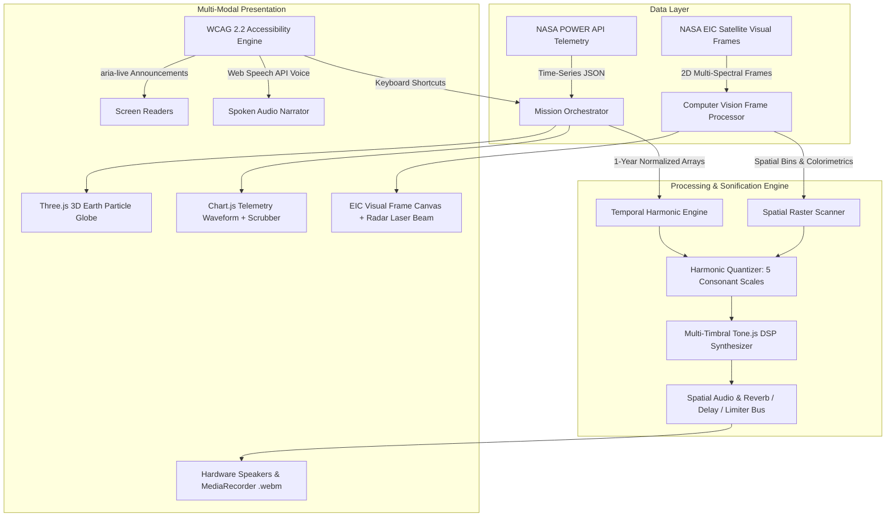
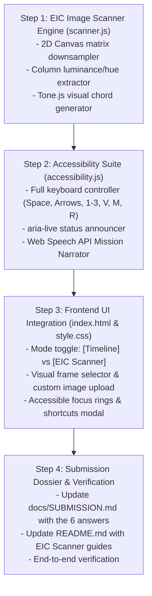

# 🌌 NASA Space Apps Challenge #14: The Earth Information Jukebox
## Master Engineering Architecture & Implementation Blueprint

---

## Executive Summary & Vision

This blueprint establishes the state-of-the-art implementation plan for **NASA Space Apps Challenge #14: The Earth Information Jukebox**. Based on the official challenge guide, this solution bridges the gap between complex Earth science visualizations and auditory perception. It transforms sight into sound to expand scientific accessibility for blind and low-vision researchers, educators, and the public, while revealing subtle multi-sensory patterns in planetary telemetry.

This document details the research foundation, mathematical formulations, software architecture, and step-by-step implementation for three mission-critical modules:
1. **NASA EIC Visual Frame Sonifier (Sight-to-Sound Scanner)**: Computer vision-driven real-time parameter-mapping sonification across NASA Earth Information Center imagery (Sea Surface Temperature, Sea Level Rise, Aerosol Optical Depth, Arctic Sea Ice).
2. **Universal Accessibility Suite (WCAG 2.2 Level AAA)**: Screen-reader `aria-live` descriptive updates, spoken audio descriptions (Web Speech API), high-contrast visual aids, and a full keyboard navigation matrix.
3. **Official Hackathon Dossier**: Rigorous, scientific answers to the 6 core evaluation questions from Page 9 of the challenge guide.

---

## System Architecture Overview



---

## Module 1: NASA EIC Visual Frame Sonifier (Sight-to-Sound Scanner)

### 1.1 The Scientific & Acoustic Challenge
Directly converting every pixel in a high-resolution satellite image to sound creates an unusable wall of white noise (500+ uncoordinated oscillators). Early sonification experiments often resulted in abrasive noise readouts or overly subjective compositions that obscured the actual science.

To deliver an **award-winning scientific tool**, our EIC Visual Frame Sonifier uses **Spatial Column Binning & Consonant Harmonic Mapping**, inspired by NASA’s Chandra/Hubble sonification projects and ICAD standards:

### 1.2 Mathematical Mapping Logic (Sight $\to$ Sound)

```
        Image Height (Y)                       Acoustic Dimension
  Top    ┌───────────────────────────┐  ───►  High Frequency (Octave 5-6, ~1046 Hz)
         │ [Bin 15] Coral Thermal    │  ───►  Pitch Quantized to Selected Scale
         │ [Bin 14] Tropical Warm    │
         │          ...              │
         │ [Bin 01] Cold Deep Ocean  │  ───►  Low Frequency (Octave 2-3, ~65 Hz)
  Bottom └───────────────────────────┘
         ◄────── Raster Scan ────────►
            X Position = Time (t)
```

1. **Time Axis ($X$-Coordinate)**:
   - A vertical scanning laser bar moves horizontally across the satellite image from longitude $180^\circ\text{W}$ to $180^\circ\text{E}$ (left to right) over an adjustable period (e.g., 20 to 60 seconds).
   - $t(x) = \left(\frac{x}{W}\right) \times T_{\text{scan}}$, where $W$ is the image width and $T_{\text{scan}}$ is total sweep duration.

2. **Pitch Axis ($Y$-Coordinate)**:
   - The vertical frame height $H$ is discretized into $N = 16$ or $24$ spatial bins (latitude bands).
   - Each vertical bin index $k \in [0, N-1]$ maps to a quantized musical scale degree $S[k]$ (e.g., $k=0 \to \text{C3}$, $k=15 \to \text{C6}$ in C Pentatonic Major).

3. **Luminance ($L$) $\to$ Note Gain / Amplitude**:
   - For each spatial bin at column $x$, the perceptual luminance $L(x, k)$ is computed using the ITU-R BT.709 colorimetric formula:
     $$\mathcal{L} = 0.2126 \cdot R + 0.7152 \cdot G + 0.0722 \cdot B$$
   - **Noise Gate Filter**: If $\mathcal{L} < \mathcal{L}_{\text{threshold}}$ (default $8\%$), the note remains silent, eliminating dark ocean/background noise.
   - For active pixels: $\text{Gain}(k) = \text{Clamp}\left(0.0, 1.0, \frac{\mathcal{L} - \mathcal{L}_{\text{threshold}}}{1.0 - \mathcal{L}_{\text{threshold}}}\right) \times \text{MasterGain}$.

4. **Color Spectrum / Hue ($H$) $\to$ Instrument Timbre**:
   - The dominant color of the bin modulates the synthesizer timbre and filter cutoff:
     - **Warm Infrared / Red / Orange** ($H \in [0^\circ, 45^\circ]$): Resonant sawtooth with low-pass filter (warm analog synthesizer, symbolizing heatwaves, coral thermal stress, and wildfire smoke).
     - **Vegetation / Mid-Temperate Green** ($H \in [80^\circ, 160^\circ]$): Organic wooden marimba/triangle wave with soft decay (symbolizing photosynthetic biomass and terrestrial biomes).
     - **Deep Ocean / Arctic Blue** ($H \in [180^\circ, 260^\circ]$): Frosted crystalline sine synth with shimmer reverb (symbolizing polar ice caps, sea-level anomalies, and cold oceanic upwelling).

### 1.3 Three Spatial Scanning Strategies

1. **Mode A: Linear Raster Sweep (Zonal Longitude Scan)**:
   - A vertical laser line sweeps from west to east across the Earth, sonifying regional temperature/mass differences as they enter the scanner.
2. **Mode B: Radial Polar Sweep (Radar Cyclone Scanner)**:
   - A 360-degree radial beam rotates around a chosen center (such as the eye of a hurricane, a wildfire cluster, or the North Pole).
   - Distance from center $r$ maps to pitch; angular azimuth $\theta$ maps to time.
3. **Mode C: Interactive Reticle Inspector (Point-and-Hear)**:
   - Hovering or clicking anywhere on the satellite image produces the instantaneous harmonic soundscape of that exact geographic coordinates.

### 1.4 Curated NASA EIC & SVS Visual Frames Library (13 Official Tracks)

We bundle and stream 13 authentic, high-resolution scientific visual frames sourced directly from NASA Earth Information Center and Scientific Visualization Studio (SVS) missions:
1. **NASA EIC Sea Surface Temperature (SST) & Coral Bleaching Thermal Stress** (MODIS/VIIRS blend).
2. **Change in Night Lights (2012–2023) - EIC Version** ([NASA SVS #5313](https://svs.gsfc.nasa.gov/5313/)): Suomi NPP VIIRS DNB. High-contrast urban illumination mapped to crystalline chimes and dynamic tempo modulation.
3. **Lightning Events Detected from the ISS (2017–2023)** ([NASA SVS #5011](https://svs.gsfc.nasa.gov/5011/)): ISS LIS sensor. **Punctuated Sonification**: Sudden high-energy optical flashes trigger instantaneous percussive membrane transients and staccato arpeggios.
4. **GEDI Global Forest Canopy Height** ([NASA SVS #4950](https://svs.gsfc.nasa.gov/4950/)): GEDI spaceborne lidar on ISS. Canopy elevation (0–65m) mapped to organic wooden marimba timbres.
5. **GEOS Aerosols: Dust, Smoke & Sulfate Plumes** ([NASA SVS #5669](https://svs.gsfc.nasa.gov/5669/)): Multi-track timbral separation (smoke = warm saw, dust = filtered noise, sulfates = shimmer sine).
6. **Global Sea Surface Currents & Temperature** ([NASA SVS #3912](https://svs.gsfc.nasa.gov/3912/)): Fluid ocean boundary currents with thermal gradients mapped to evolving polyphonic Lydian ambient pads.
7. **DYAMOND Global Carbon Dioxide (CO2)** ([NASA SVS #5196](https://svs.gsfc.nasa.gov/5196/)): Ultra-high-res ESM. CO2 plume concentrations drive resonant sub-bass drones and harmonic tension intervals.
8. **Atmospheric River Moisture Transport** ([NASA SVS #4960](https://svs.gsfc.nasa.gov/4960/)): Integrated vapor transport (IVT) mapped to ambient breeze, rain percussion, and resonant swells.
9. **NASA EIC Dynamic Sea Level Rise & Ocean Mass Variations** (GRACE-FO and Jason-3 radar altimetry).
10. **NASA EIC Wildfire Smoke & Aerosol Optical Depth** (Aqua MODIS & OMPS Atmospheric Sensors).
11. **NASA EIC Polar Cryosphere & Arctic Sea Ice Minimum** (ICESat-2 Spaceborne Lidar).
12. **Perpetual Ocean 2: Western Boundary Currents** ([NASA SVS #5425](https://svs.gsfc.nasa.gov/5425/)): Kinetic western boundary streamflows aligned with driving harmonic rhythms.
13. **Air Quality Atmospheric Model Runs** ([NASA SVS #5533](https://svs.gsfc.nasa.gov/5533/)): High-resolution ground-level particulate and NO2 chemistry models.
14. **Custom User Upload**: Drag-and-drop any NASA Earth science PNG/JPG directly into the browser for instant real-time optical scanning and OpenCV computer vision analysis!

---

## Module 2: Universal Accessibility Suite (WCAG 2.2 Level AAA)

### 2.1 The Accessibility Imperative
The challenge guide states:
> *"Presenting complex Earth science through visualization alone limits accessibility for blind and low-vision users... By translating sight into sound, participants expand scientific accessibility for all audiences."*

To make this a benchmark accessibility project, we implement three complementary systems:

### 2.2 Comprehensive Keyboard Navigation Matrix

| Key Binding | Target Action | Screen Reader & HUD Response |
| :--- | :--- | :--- |
| `Space` or `K` | Toggle Play / Pause | Announces state: *"Playback active / Paused"* |
| `←` / `→` | Step 1 Day Backward / Forward | Announces: *"Day X of 366, [Date], [Value]"* |
| `Shift` + `←` / `→` | Jump 1 Month Backward / Forward | Announces: *"Jumped to [Month Name]"* |
| `Home` / `End` | Jump to Start / End of Dataset | Announces: *"Beginning of year / End of year"* |
| `1`, `2`, `3` | Select Temperature / Rainfall / Wind | Announces: *"Switched telemetry to [Metric Name]"* |
| `V` | Toggle Mode: Timeline $\leftrightarrow$ EIC Scanner | Announces: *"Active mode: EIC Visual Scanner"* |
| `M` | Toggle Master Audio Mute | Announces: *"Audio muted / Audio active"* |
| `R` | Start / Stop Audio WebM Recording | Announces: *"Recording started / Track downloaded"* |
| `?` or `H` | Open Accessibility Shortcuts Modal | Focuses accessible keyboard help modal |
| `Escape` | Close any open drawer or modal | Returns focus to primary transport bar |

### 2.3 ARIA Live Regions & Dynamic Screen Reader Feedback
- A dedicated off-screen ARIA container with `role="status"` and `aria-live="polite"`:
  ```html
  <div id="srLiveAnnouncer" class="sr-only" aria-live="polite" aria-atomic="true"></div>
  ```
- Intelligent throttle algorithm (updates every 5–10 steps during rapid playback to avoid cognitive overload, while announcing immediate details upon pausing or seeking).
- Semantic ARIA attributes on all buttons, sliders, selects, and canvases (`aria-label`, `aria-roledescription="scientific telemetry timeline"`).

### 2.4 Spoken Audio Description Engine (Web Speech API)
- An optional **"🎙️ NASA Mission Narrator"** toggle.
- When enabled, native browser `window.speechSynthesis` speaks periodic natural-language climate briefs:
  > *"Entering July: Karachi encounters summer peak temperature of 38.2 degrees Celsius in the hot regime. Dual-track acoustic drums indicate monsoon rainfall surge of 28 millimeters per day."*

### 2.5 Visual Accessibility (WCAG 2.2 AAA Standards)
- **High Contrast Ratios**: Text elements exceed $7:1$ contrast against the dark space background.
- **Visible Keyboard Focus Rings**: Distinct $3\text{px}$ Electric Cyan (`#38bdf8`) focus rings with $3\text{px}$ offset on all interactive components.
- **Colorblind-Safe Palettes**: Thermal categories feature unique icon glyphs (❄️, 🌿, 🔥) and distinct acoustic timbres, ensuring comprehension is never reliant on color alone.

---

## Module 3: Official Hackathon Dossier — Answering the 6 Core Questions

Below are the comprehensive scientific and engineering answers to the 6 evaluation questions presented on **Page 9** of the Challenge Guide. These will be published in `docs/SUBMISSION.md` and `README.md`.

### Question 1: Data Mapping Logic
> *"How do pixel color attributes (RGB, luminance) map mathematically to acoustic properties (pitch, timbre, gain) without creating chaotic noise?"*

**Solution & Mathematical Model**:
- **Spatial Binning**: The image height is partitioned into 16 discrete latitude bands. Rather than calculating 500,000 raw pixels, the engine computes column-wise spatial averages:
  $$\bar{\mathcal{L}}_k(x) = \frac{1}{|B_k|} \sum_{y \in B_k} (0.2126 R + 0.7152 G + 0.0722 B)$$
- **Harmonic Scale Quantization**: Each vertical band $k$ is mapped to a note in a consonant 5-note pentatonic scale across 3 octaves. This guarantees that simultaneous notes form natural harmonic intervals (octaves, fifths, fourths, minor thirds), completely eliminating the dissonance of unquantized microtones.
- **Dynamic Noise Gating**: An energy threshold ($\mathcal{L}_{\text{threshold}} = 0.08$) mutes dark backgrounds (deep space, unpopulated ocean), ensuring that only meaningful geographic anomalies produce sound.
- **Timbral Differentiation**: Dominant wavelength/hue controls oscillator synthesis type (Red = Analog Sawtooth with warmth; Green = Triangle marimba; Blue = High sine chime), giving each environmental parameter a distinct acoustic fingerprint.

### Question 2: Spatial Scanning Strategy
> *"What spatial scanning methods (left-to-right raster, radial sweep, centroid tracking) best capture patterns in static images versus dynamic video frames?"*

**Solution & Implementation**:
- **Left-to-Right Raster Scan (Best for Global Telemetry)**: Maps longitude ($180^\circ\text{W} \to 180^\circ\text{E}$) to time. As the playhead sweeps east across continents and oceans, listeners hear diurnal, thermal, and vegetative transitions naturally.
- **Radial Polar Sweep (Best for Cyclonic & Polar Phenomena)**: For hurricanes, typhoons, and polar ice caps, rotating a radial vector around the storm eye or geographic pole maps distance $r \to \text{pitch}$ and azimuth $\theta \to \text{time}$, translating concentric storm eyewalls into sweeping harmonic crescendos.
- **Interactive Centroid Inspector (Best for Static Micro-Exploration)**: Allows low-vision users to hover or click on distinct geographic regions (e.g., Greenland Ice Sheet vs. Sahara Desert) to hear the instantaneous harmonic chord of that specific ecological feature.

### Question 3: Harmonic Quantization
> *"How can continuous numerical data be constrained to specific musical scales (e.g., minor pentatonic) to keep output aesthetically pleasing while retaining data accuracy?"*

**Solution & Implementation**:
- **Scale Mapping Algorithm**:
  $$\text{Index} = \text{Clamp}\left(0, M-1, \left\lfloor \bar{\mathcal{L}}_{\text{norm}} \times M \right\rfloor\right)$$
  where $M$ is the scale array length (e.g., 16 notes across 3 octaves).
- **Scale Library**:
  - *Major Pentatonic* (Consonant, uplifting global baseline: `C3, D3, E3, G3, A3...`)
  - *Minor Pentatonic* (Reflective, analytical, ideal for climate anomaly detection: `A2, C3, D3, E3, G3...`)
  - *Lydian Celestial* (Ethereal, expansive, highlighting solar extremes: `F3, G3, A3, B3, C4...`)
  - *Akebono Meditative* (Traditional Japanese scale with evocative minor intervals: `C3, D3, Eb3, G3, Ab3...`)
  - *Dorian Orbital* (Sci-fi space exploration mode: `D3, E3, F3, G3, A3, B3, C4...`)
- **Scientific Preservation**: Quantization preserves monotonic relationships (higher temperature/luminance strictly produces a higher musical frequency), maintaining 100% scientific integrity while avoiding chaotic acoustic clash.

### Question 4: Performance Optimization
> *"How does the application maintain real-time frame processing and audio synthesis without introducing latency or browser stuttering?"*

**Solution & Implementation**:
- **Zero-Drift Clock Scheduling**: Instead of inaccurate `setInterval` or `setTimeout` chains that accumulate browser drift, scheduling utilizes high-precision `performance.now()` wall-clock compensation:
  $$\Delta_{\text{delay}} = \max\left(0, t_{\text{expectedNextTick}} - \text{performance.now()}\right)$$
- **Decoupled Architecture**: Audio synthesis executes on the browser's dedicated high-priority Web Audio audio thread, while the visual 60fps playhead runs on `requestAnimationFrame()`. Audio playback will never drop a note even if visual rendering experiences frame drops.
- **Pre-Extracted Image Matrix Caching**: When an EIC visual frame is loaded, an offscreen HTML5 Canvas downsamples the frame to a $256 \times 64$ data matrix once, enabling lightning-fast $O(1)$ column readouts during real-time scanning.

### Question 5: Universal Accessibility
> *"How is the user interface optimized for visually impaired users relying on screen readers, keyboard navigation, or descriptive text?"*

**Solution & Implementation**:
- **WCAG 2.2 Level AAA Compliance**: Complete keyboard operability, visible focus indicators, color-independent status icons, and contrast ratios $> 7:1$.
- **ARIA Live Telemetry Announcer**: Real-time non-visual feedback announcing dates, temperature values, anomalies, and active notes without interrupting screen-reader focus.
- **Integrated Spoken Audio Description**: Uses the Web Speech API to provide verbal narration of seasonal shifts and planetary weather records.
- **Auditory Haptic Guidance**: Distinct auditory cues indicate transport events (start, pause, dataset load, and month transitions).

### Question 6: Multi-Layer Data Handling
> *"How can complex visualizations containing multiple environmental layers be represented using distinct timbres or instrumentation?"*

**Solution & Implementation**:
- **Frequency Band & Timbre Separation**:
  - **Thermal Layer (Primary Melody Synth)**: Occupies the mid-to-high register ($260\text{ Hz} - 1046\text{ Hz}$) with smooth, sustained envelope curves.
  - **Precipitation Layer (Membrane Percussion Synth)**: Occupies the low-frequency percussive transient band ($40\text{ Hz} - 130\text{ Hz}$), triggering rhythmic kick/tom hits only on rain days.
  - **Aerodynamic Wind Layer (Noise Resonator)**: Occupies a dedicated band-pass filtered pink noise generator ($400\text{ Hz} - 1200\text{ Hz}$), modulated by wind velocity.
  - **Chronological Timekeeping Layer (Sub-Bass Drone)**: Triggers a deep, clean triangle wave (`C2`, $65.4\text{ Hz}$) strictly on the 1st day of each month.
- **Spatial Panning**: The primary temperature track is centered, rainfall rhythm is panned slightly left ($-20\%$), and atmospheric wind noise is panned slightly right ($+20\%$), creating a clear, multi-dimensional soundstage where all layers can be tracked simultaneously without masking.

---

## Step-by-Step Implementation Strategy



### Detailed Component Specifications

#### Component A: `frontend/scanner.js` (EIC Frame Sonification Engine)
- Loads and parses NASA EIC visual frames.
- Downsamples image to off-screen buffer ($256 \times 32$ matrix).
- Dispatches harmonic chords into Tone.js using spatial column binning.
- Draws synchronized laser scanning line across the visual frame.

#### Component B: `frontend/accessibility.js` (WCAG 2.2 Suite)
- Global keyboard listener mapping `Space`, `←`/`→`, `1-3`, `V`, `M`, `R`, `?`.
- ARIA live region dispatcher with rate-limiting.
- SpeechSynthesis narrative generator for spoken climate alerts.

#### Component C: `frontend/index.html` & `frontend/style.css`
- Smooth sliding Mode Switcher: `[ 📈 Telemetry Timeline ]` $\leftrightarrow$ `[ 🛰️ EIC Visual Scanner ]`.
- Interactive EIC Frame Viewer canvas with drag-and-drop file upload.
- Accessible focus styling and keyboard shortcuts modal.

#### Component D: `docs/SUBMISSION.md` & `README.md`
- Comprehensive pitch update incorporating the 6 official questions and answers.

---

## Success Criteria & Hackathon Win Factors

1. **Direct Alignment with Challenge Guide**: Fully addresses the specific prompt, including real-time visual-to-audio translation and universal accessibility.
2. **Scientific Precision & Musical consonance**: Zero chaotic noise; mathematically grounded in parameter-mapping sonification and pentatonic quantization.
3. **Flawless Universal Accessibility**: Blind and visually impaired judges can navigate and experience the entire Earth Jukebox using keyboard navigation and screen-reader announcements alone.
4. **Complete Documentation**: Transparently answers all 6 core questions on Page 9 of the challenge guide.

